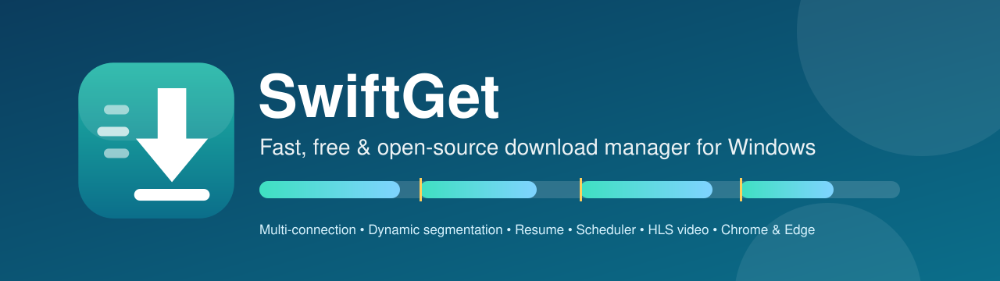
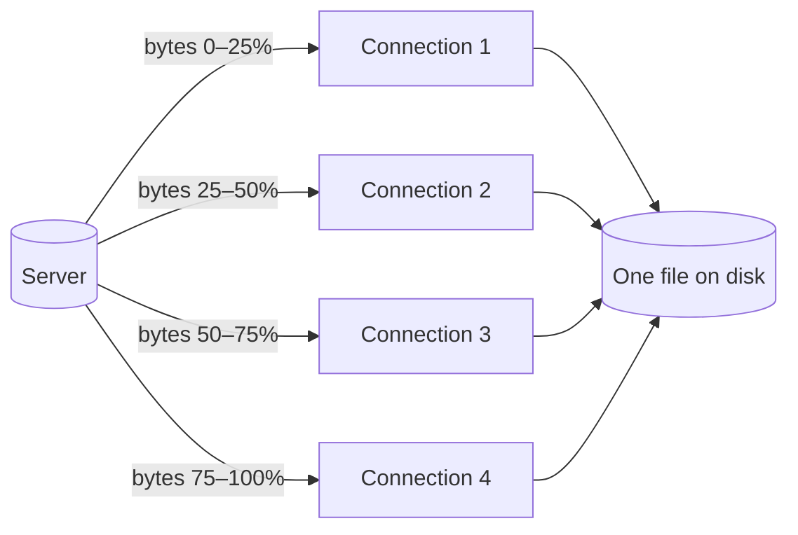

<div align="center">



# SwiftGet: Fast, Free & Open-Source Download Manager for Windows

**A modern, open-source IDM alternative that accelerates downloads with multiple connections,
resumes broken downloads, schedules queues and integrates with Chrome and Edge.**

[](https://github.com/ShubratoDn/idm-clone-swiftget/releases/latest)
[](https://github.com/ShubratoDn/idm-clone-swiftget/releases)
[](https://github.com/ShubratoDn/idm-clone-swiftget/actions/workflows/ci.yml)
[](LICENSE)


[**⬇ Download for Windows**](https://github.com/ShubratoDn/idm-clone-swiftget/releases/latest) ·
[Features](#features) ·
[Browser extension](#browser-extension-chrome--edge) ·
[How it works](#how-swiftget-accelerates-downloads) ·
[FAQ](#faq) ·
[Build from source](#build-from-source)

</div>

---

SwiftGet is a **free download manager and download accelerator for Windows 10 and 11**. Instead of
downloading a file over a single connection like a web browser, SwiftGet splits it into parts and
downloads them **in parallel over up to 32 connections**. Its **dynamic file segmentation** keeps every
connection busy until the last byte. Downloads can be **paused and resumed** at any time, even after a
restart, and a **scheduler**, **speed limiter**, **HLS video downloader** and **browser integration** are built in.

The interface follows the classic, familiar download-manager layout (categories, download list,
per-download progress window with a live connection map), so it feels at home from the first minute.
The download engine is written in **Rust** for speed and a small memory footprint, and the installer
is under 3 MB.

## Table of contents

- [Features](#features)
- [Download & install](#download--install)
- [Browser extension (Chrome & Edge)](#browser-extension-chrome--edge)
- [How SwiftGet accelerates downloads](#how-swiftget-accelerates-downloads)
- [Benchmarks](#benchmarks)
- [Usage tips](#usage-tips)
- [FAQ](#faq)
- [Build from source](#build-from-source)
- [Roadmap](#roadmap)
- [Contributing](#contributing)
- [License](#license)

## Features

### ⚡ Download acceleration
- **Multi-connection downloading**: 1–32 simultaneous connections per file, each over its own TCP connection.
- **Dynamic segmentation**: when a connection finishes, it takes over half of the largest remaining part, so no slow tail.
- **Smart server handling**: if a server caps connections or rate-limits (HTTP 429/503), SwiftGet carries on
  with the connections that work and honours `Retry-After`, instead of failing.
- **Sparse preallocation** on NTFS, so large files start downloading instantly without zero-filling the disk.

### ⏯ Reliable resume
- Pause and resume any download that the server allows ranges for; progress survives app restarts and reboots.
- Automatic retries with back-off for dropped connections and timeouts.
- Detects files that changed on the server (size/ETag) and restarts them safely.

### 🗂 Organisation & queue
- Automatic categories: **Compressed, Documents, Music, Programs, Video**, each saved to its own folder.
- Download queue with a configurable number of simultaneous downloads.
- **Scheduler**: start and stop the queue at set times, daily or on chosen weekdays.
- **When done**: exit SwiftGet, put the PC to sleep or shut it down after the queue finishes.

### 🎛 Control
- **Global speed limiter** shared by all downloads.
- Per-download progress window with transfer rate, time left, resume capability and a **live map of every connection**.
- "Download complete" dialog with *Open* and *Open folder*.

### 🌐 Browser integration & video
- **Chrome and Edge extension** that captures downloads with the page's cookies, referrer and user agent,
  so downloads that need you to be signed in work too.
- **Download with SwiftGet** in the right-click menu for links, videos and audio.
- **Video stream detection**: finds HLS (`.m3u8`) streams and media files on the page.
- **HLS downloader**: best quality variant, parallel segments, AES-128 decryption, optional MP4 remux with ffmpeg.

### 🪟 Desktop integration
- System-tray icon with live speed tooltip, close-to-tray, launch at Windows startup.
- Clipboard detection prefills the *Add URL* box.
- Single-instance app, and no telemetry.

## Download & install

1. Go to the [**latest release**](https://github.com/ShubratoDn/idm-clone-swiftget/releases/latest).
2. Download **`SwiftGet_x.y.z_x64-setup.exe`** (recommended) or the **`.msi`** package.
3. Run the installer. SwiftGet appears in the Start menu and the system tray.

| Requirement | |
| --- | --- |
| OS | Windows 10 or Windows 11 (64-bit) |
| Runtime | Microsoft Edge WebView2 (included in Windows 11; installed automatically if missing) |
| Disk | ~10 MB |

> **"Windows protected your PC"?** The installer is not code-signed yet. Click **More info → Run anyway**.
> Every release includes `SHA256SUMS.txt` so you can verify your download.

## Browser extension (Chrome & Edge)

1. Download `SwiftGet_browser-extension_vX.Y.Z.zip` from the [latest release](https://github.com/ShubratoDn/idm-clone-swiftget/releases/latest) and unzip it
   (or use the [`extension`](extension/) folder from this repository).
2. Open `chrome://extensions` (Chrome) or `edge://extensions` (Edge) and turn on **Developer mode**.
3. Click **Load unpacked** and select the extension folder.
4. Start SwiftGet. The extension popup should show **connected**.

Downloads whose file type is listed in **Options → File types** are handed to SwiftGet automatically;
everything else stays in the browser. If SwiftGet is not running, the browser downloads normally.

<details>
<summary><b>What the extension can access and why</b></summary>

| Permission | Why it is needed |
| --- | --- |
| `downloads` | Detect new browser downloads and hand them to SwiftGet |
| `cookies` | Send your session cookies for that one URL, so downloads that need a sign-in work |
| `webRequest` | Detect video/audio streams on the page |
| `contextMenus` | "Download with SwiftGet" menu items |
| `storage`, `tabs` | Remember settings and show media found in the current tab |

The extension talks only to SwiftGet on `127.0.0.1` (your own computer). Nothing is sent anywhere else.
</details>

## How SwiftGet accelerates downloads

Many servers limit the speed of **each connection**. A browser uses one connection; SwiftGet uses several at once:



1. **Probe**: SwiftGet asks for the first byte (`Range: bytes=0-0`). A `206 Partial Content` answer
   means the server supports ranges, and it reports the file size.
2. **Split**: the file is preallocated and divided into ranges, each fetched by its own HTTP/1.1 connection
   and written directly to its position in the file.
3. **Rebalance**: when a connection finishes early, it takes over the second half of the slowest remaining
   range, keeping all connections busy until the end.
4. **Finish**: the completed file is renamed into place. Paused downloads keep their range map so they can resume.

Read the full design in [docs/ARCHITECTURE.md](docs/ARCHITECTURE.md).

## Benchmarks

Measured with SwiftGet's own test suite (`cargo test`) and a real-world run:

| Scenario | 1 connection | 8 connections | Result |
| --- | --- | --- | --- |
| Server limiting each connection to 2 MB/s (8 MB file, local test) | 4.4 s | **0.56 s** | **~7.9× faster** |
| Public speed-test server, 100 MB, ~24 Mbps home connection | 2.42 MB/s | **2.90 MB/s** | ~20% faster (line speed reached) |

**What to expect:** the speed-up is largest when a server limits per-connection speed or is far away (high latency).
If a single connection already fills your internet plan, no download manager can go faster than your line.

## Usage tips

| Action | How |
| --- | --- |
| Add a download | **Add URL** (Ctrl+N), paste a link, then *Start Download* or *Download Later* |
| Open a finished file | Double-click it |
| Show live progress again | Double-click an unfinished download, right-click → **Show download progress**, or press **Resume** |
| Bring back the main window | Click the SwiftGet icon in the system tray (closing the window keeps SwiftGet running) |
| Resume / stop | Select downloads, then **Resume** / **Stop**, or use the right-click menu |
| Download everything later | Add with *Download Later*, then **Start Queue** or use the **Scheduler** |
| Limit bandwidth | **Speed Limiter** in the toolbar, or click the status bar |
| More connections | **Options → Downloads → Max. connections per download** |

## FAQ

<details>
<summary><b>Is SwiftGet free?</b></summary>

Yes. SwiftGet is completely free and open source under the MIT license: no trial, no ads, no telemetry.
</details>

<details>
<summary><b>Is SwiftGet a good alternative to Internet Download Manager (IDM)?</b></summary>

SwiftGet offers the core features people use a download manager for: multi-connection acceleration with
dynamic segmentation, pause/resume, queue, scheduler, speed limiter, video stream downloads and browser
integration, with a familiar interface. It is free and open source. See the [roadmap](#roadmap) for features that are not included yet.
</details>

<details>
<summary><b>Does SwiftGet make every download faster?</b></summary>

No download manager can exceed your internet connection's speed. SwiftGet helps most when a server limits
per-connection speed, when the server is far away, or when a connection drops and needs to resume. On servers
without range support it falls back to a single connection.
</details>

<details>
<summary><b>Which browsers are supported?</b></summary>

Google Chrome, Microsoft Edge and other Chromium-based browsers (Brave, Opera, Vivaldi) via the included
Manifest V3 extension. Firefox support is on the roadmap. You can always paste a link into **Add URL**.
</details>

<details>
<summary><b>Can SwiftGet download videos?</b></summary>

Yes, for HLS (`.m3u8`) streams and direct media files that the extension detects while a video plays.
DRM-protected streams are not supported, by design. Install [ffmpeg](https://ffmpeg.org/) to get `.mp4` output instead of `.ts`.
</details>

<details>
<summary><b>Where are my files and settings saved?</b></summary>

Files go to your *Downloads* folder, into a subfolder per category (configurable in **Options → Save to**).
The download list and settings are stored in `%APPDATA%\com.swiftget.app\state.json`.
</details>

<details>
<summary><b>Why does Windows SmartScreen warn about the installer?</b></summary>

The installer is not code-signed yet, so Windows does not recognise the publisher. The source code is public,
releases are built by [GitHub Actions](.github/workflows/release.yml), and each release includes SHA-256 checksums.
</details>

## Build from source

Requirements: Windows 10/11, [Rust](https://rustup.rs/) (MSVC toolchain + Visual Studio C++ Build Tools),
[Node.js](https://nodejs.org/) 20+.

```powershell
git clone https://github.com/ShubratoDn/idm-clone-swiftget.git
cd idm-clone-swiftget
npm install

npx tauri dev     # run in development mode with hot reload
npx tauri build   # release build: installers in src-tauri/target/release/bundle/
```

Run the tests:

```powershell
cd src-tauri
cargo test
```

### Tech stack

| Layer | Technology |
| --- | --- |
| Download engine | Rust, Tokio, reqwest (HTTP/1.1), AES-128-CBC for HLS |
| Desktop shell | Tauri 2 (WebView2), system tray, notifications, autostart |
| Interface | React 19, TypeScript, Vite |
| Browser extension | Chrome/Edge Manifest V3 |
| CI/CD | GitHub Actions (tests, Windows installers, releases) |

### Project structure

```
src-tauri/src/
  engine/http.rs       segmented downloader, dynamic splitting, retries
  engine/hls.rs        HLS playlists, AES-128, joining
  engine/probe.rs      range support, size and file-name detection
  engine/limiter.rs    global speed limiter
  manager.rs           queue, persistence, progress reporting
  scheduler.rs         timed start/stop, post-completion actions
  server.rs            local bridge for the browser extension
src/                   React UI (main window, dialogs, progress/add/complete windows)
extension/             Chrome/Edge extension
docs/                  architecture, release notes, assets
```

## Roadmap

- [ ] Firefox extension
- [ ] DASH (`.mpd`) and HLS streams with separate audio tracks (ffmpeg muxing)
- [ ] Proxy / SOCKS settings and per-site logins
- [ ] Multiple named queues
- [ ] Per-download speed limits
- [ ] Batch download (URL patterns) and site grabber
- [ ] Code-signed installer and auto-update
- [ ] Light/dark theme options

Have an idea? [Open a feature request](https://github.com/ShubratoDn/idm-clone-swiftget/issues/new/choose).

## Contributing

Contributions are welcome! Read [CONTRIBUTING.md](CONTRIBUTING.md) to get started, and please follow the
[Code of Conduct](CODE_OF_CONDUCT.md). Found a security issue? See [SECURITY.md](SECURITY.md).

If SwiftGet is useful to you, please ⭐ **star the repository**. It helps others find it.

## License

SwiftGet is released under the [MIT License](LICENSE).

---

<sub>SwiftGet is an independent open-source project. It is not affiliated with, endorsed by or connected to
Tonec Inc. or Internet Download Manager (IDM). All product names and trademarks are the property of their
respective owners and are used only to describe compatibility and alternatives.</sub>
