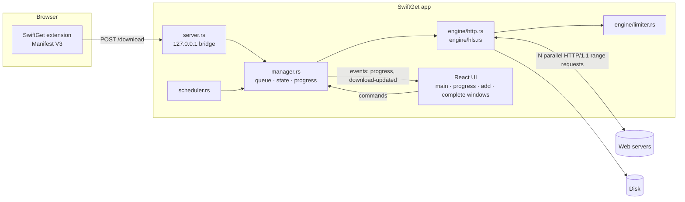

# SwiftGet Architecture

SwiftGet is a [Tauri 2](https://tauri.app/) desktop app. The download engine and everything stateful
lives in Rust; the interface is a React app rendered in WebView2. The two talk through Tauri commands
(UI → Rust) and events (Rust → UI).



## Download engine (`src-tauri/src/engine`)

### 1. Probe — `probe.rs`

Before downloading, SwiftGet requests the first byte with `Range: bytes=0-0`:

- `206 Partial Content` + `Content-Range: bytes 0-0/<total>` → the server supports ranges, so the file
  can be split and resumed; the total size is known.
- `200 OK` → no range support; one connection, no resume.

The file name comes from `Content-Disposition` (including RFC 5987 `filename*=`), falling back to the URL
path and the MIME type. `.m3u8` URLs and `mpegurl` content types are handed to the HLS engine.

### 2. Segmented download — `http.rs`

The file is preallocated as `<name>.swg` (marked sparse on NTFS so writing far into it does not force
Windows to zero-fill everything before it) and split into up to *N* byte ranges:

```
[==== conn 1 ====][==== conn 2 ====][==== conn 3 ====][==== conn 4 ====]
```

Each range is fetched by its own worker over its own TCP connection. The HTTP client is forced to
**HTTP/1.1**; with HTTP/2 all requests would be multiplexed over one connection, which defeats the purpose.
Workers write with positional writes (`seek_write`) into the shared file, in 256 KB batches.

**Dynamic segmentation.** When a worker finishes its range, the largest range still in progress is cut in
half and the free worker takes the second half:

```
before:  [## conn 1 done ##][#### conn 2 ...........................]
after:   [## conn 1 done ##][#### conn 2 .......][conn 1 → .........]
```

The original worker keeps reading its existing response and stops at the new boundary, so no bytes are
fetched twice. This keeps every connection busy until the end and avoids a slow last segment.

**Resume.** Each range's `start`, `end` and current `pos` are saved to `state.json` every few seconds and
on pause/exit. On resume the probe runs again; if the size or ETag changed, the download restarts.

**Retries and hostile servers.**

- Every worker retries with exponential back-off (up to *Max retries*, default 20). A failure that
  still saved data resets the counter.
- If a server refuses extra connections, those workers give up after a few quick attempts. Their
  range is merged back into the range it was cut from (`merge_back`), and the download continues
  with the connections that work.
- On `429 Too Many Requests` / `503`, the worker waits for `Retry-After`, and range splitting pauses for 30 s.

### 3. HLS — `hls.rs`

For a master playlist the highest-`BANDWIDTH` variant is chosen. Media segments are downloaded in parallel
into `<name>.swg.parts/`, AES-128 segments are decrypted (explicit IV or media-sequence IV), and the parts
are joined into one `.ts` file (or `.mp4` for fMP4 streams with `#EXT-X-MAP`). If `ffmpeg` is on the PATH,
`.ts` output is remuxed losslessly to `.mp4`. Already-downloaded segments are skipped on resume.

### 4. Speed limiter — `limiter.rs`

A single token bucket shared by every connection of every download. A worker that overdraws the bucket
sleeps until the debt is repaid, so the total rate converges on the limit regardless of the number of connections.

## Manager (`manager.rs`)

- Owns the list of downloads, settings and schedule, persisted atomically to
  `%APPDATA%\com.swiftget.app\state.json`.
- `pump()` starts queued downloads until *Max. simultaneous downloads* are running.
- A reporter samples every running task twice a second and emits a `progress` event with speed
  (smoothed), ETA, active connections and the segment map. It also updates the tray tooltip.
- When a download finishes it closes the progress window, opens the *Download complete* dialog, and runs
  the scheduler's *when done* action once the queue is empty.

## Browser bridge (`server.rs`) and extension (`extension/`)

The extension reaches the app at `http://127.0.0.1:52817`:

| Endpoint | Purpose |
| --- | --- |
| `GET /ping` | App presence, version and the file-type capture list |
| `POST /download` | `{ url, referrer, cookies, userAgent, fileName, kind }` |

Requests with a web-page `Origin` are rejected, and `/download` requires an `X-SwiftGet` header (which forces
a CORS preflight that the app never approves), so websites cannot drive the app.

The extension:

- intercepts `chrome.downloads` whose type matches the capture list, cancels them in the browser and sends
  them to SwiftGet with the page's cookies and referrer, falling back to the browser if the app is not running;
- adds **Download with SwiftGet** to the link and media context menus;
- watches responses for `.m3u8` playlists and media files (`extension/media.js`) and lists them in the
  popup. Files played by a `<video>`/`<audio>` element are accepted even as `206` range replies, with
  their size read from `Content-Range`; slice parameters such as `bytestart`/`byteend` are removed so
  the download always covers the whole file. Pieces fetched by MediaSource players are ignored;
- shows a **Download this video** button over videos (`extension/content.js`, in a closed Shadow DOM).
  It offers the video's own URL first, then the streams the tab loaded.

## UI (`src/`)

Every window loads the same bundle. Secondary windows are created by Rust (`windows.rs`), which injects
the route (`progress/<id>`, `complete/<id>`, `add/<token>`) before the page runs.

| File | Window |
| --- | --- |
| `main-window/MainWindow.tsx` | Menu bar, toolbar, categories tree, download list, status bar |
| `windows/AddWindow.tsx` | Download File Info (URL, category, save as, size) |
| `windows/ProgressWindow.tsx` | Per-download status, speed limiter, completion options, connection map |
| `windows/CompleteWindow.tsx` | Download complete (Open / Open folder) |
| `main-window/OptionsDialog.tsx`, `SchedulerDialog.tsx` | Configuration and scheduler |

`useStore.ts` mirrors the backend state from a snapshot plus `download-updated`, `download-removed` and
`progress` events.
